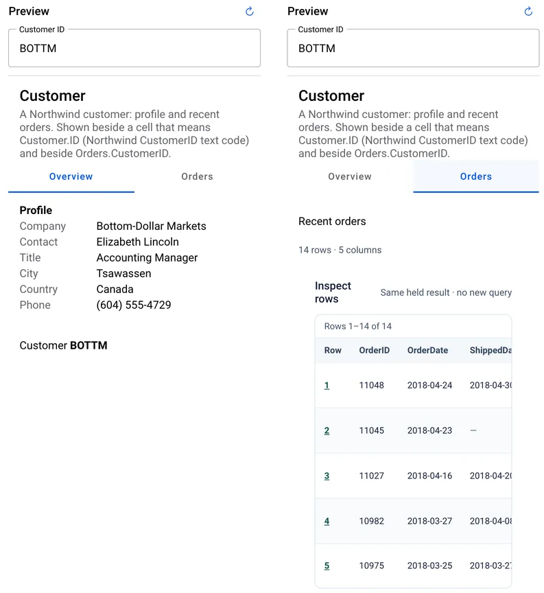
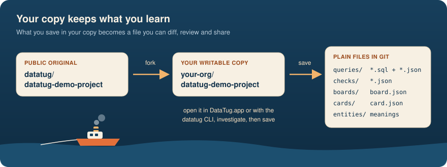
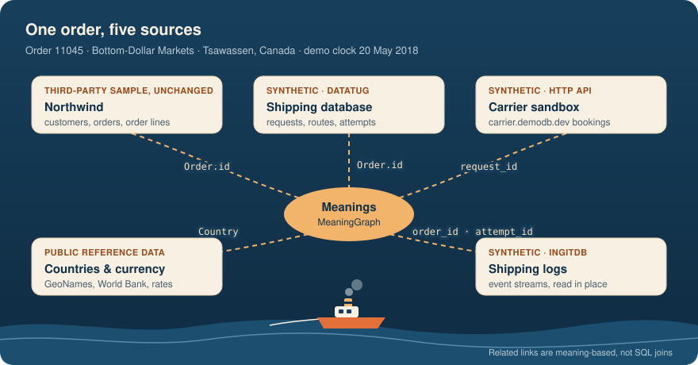
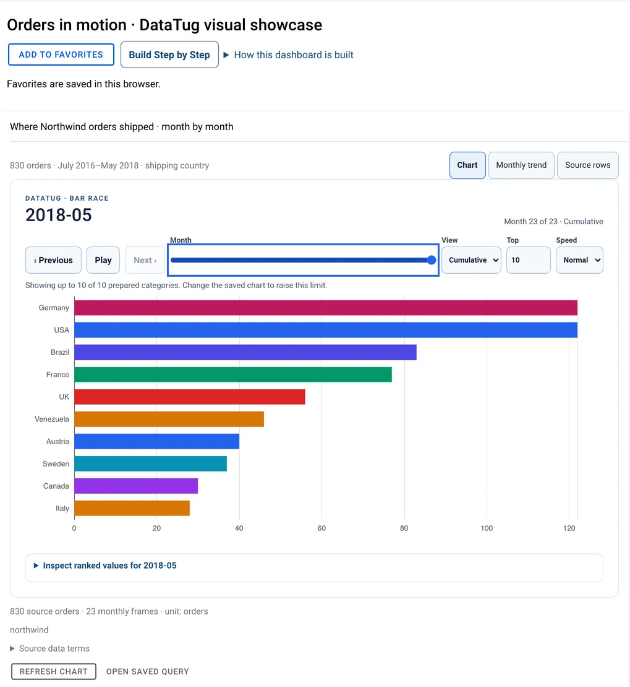

# The case of order 11045

**A demo project for [DataTug](https://datatug.app): follow one late order across databases, an
HTTP API and logs, then save what you learned as files in your own Git repository.**

[Open the demo project in DataTug](https://datatug.app/project/github.com/datatug/datatug-demo-project/tree/HEAD/demo-project-1)
· [Fork it to keep your own copy](https://github.com/datatug/datatug-demo-project/fork)
· [Sign in to DataTug](https://datatug.app/login)

It is 20 May 2018 in the demo. Bottom-Dollar Markets of Tsawassen, Canada, calls support: their
order **11045** is due tomorrow and still has not shipped. The answer is spread over places you
probably recognise from your own job: the order system, a separate shipping database, a carrier
API and a stream of logs. This project gives DataTug everything it needs to walk that trail with
you, using public data and nothing to install.

<p align="center">
  
  <br><sub>The project's Customer card on datatug.app, signed out: order 11045 has no shipped date.</sub>
</p>

## What you can do

The story is told in acts. The first five need no account.

| Act | You… | DataTug shows you |
|---|---|---|
| 1 Find | look up the caller and open the customer card | saved cards and parameterised queries |
| 2 Follow | go from the Northwind order to its shipping request | foreign-key joins inside one database, and *Related* records across databases through shared meanings |
| 3 Ask the carrier | ask the carrier sandbox about 11045 and the healthy order 11038 | HTTP queries whose parameters come from rows you selected |
| 4 Add the world | bring in countries and a dated currency rate | public reference data next to your own |
| 5 Read the logs | filter the shipping logs by the request's `order_id` and `attempt_id` | logs read where they live, with no ingestion |
| 6–9 Fix it | raise an Incident, investigate, teach DataTug the missing link, watch a Check go red and then green after the replay | incidents, checks and meanings, in your own writable training copy |

From Act 6 you sign in, because those steps change data: you work in your own copy and the public
original is never touched. The guided demo is still being prepared and will open at
[datatug.app/demo](https://datatug.app/demo). Everything in this repository can be opened and
read today.

## Why your own copy

DataTug keeps a project as plain files in Git. When you investigate in your copy, the queries,
checks, boards and meanings you save are files in *your* repository: you can diff them, review
them in a pull request and hand them to the next person who gets the same call. That is the point
of the story, too. Order 11062 hits the same problem later that morning, and the saved
investigation already knows the way.

<p align="center">
  
</p>

Two ways to get one:

- **On GitHub:** [fork this repository](https://github.com/datatug/datatug-demo-project/fork), then
  open `https://datatug.app/project/github.com/<you>/datatug-demo-project/tree/HEAD/demo-project-1`.
- **From DataTug:** after you edit the demo's browser database, choose **Copy this demo project to
  GitHub**.

## The demo universe

One order, five sources, and a set of meanings that tell DataTug which columns talk about the same
thing.

<p align="center">
  
</p>

- **Northwind**, the classic sample database, unchanged: customers, orders and order lines.
- **Shipping**, a synthetic database made for this demo: requests, routes, attempts and
  assignments, with the business clock stopped at 20 May 2018 10:00 UTC.
- **The carrier sandbox** at [carrier.demodb.dev](https://carrier.demodb.dev/): a static,
  read-only HTTP API that answers "is there a booking for this request?" Every response is
  labelled synthetic. Its
  [`shipping/carrier-status`](demo-project-1/queries/shipping) query is live-only and
  intentionally has no offline fixture.
- **Shipping logs**, synthetic event streams published as a native inGitDB database.
- **Countries and currencies**: GeoNames and World Bank data vendored in this repository, and a
  public exchange-rate API.

Northwind and the other third-party samples are never edited. Everything the story adds lives in
DataTug-owned sources.

## What's in this repository

The DataTug project lives in [`demo-project-1/`](demo-project-1), a sub-folder, so the same layout
can sit inside an existing repository without conflicts.

| Folder | What it holds |
|---|---|
| [`queries/`](demo-project-1/queries) | saved SQL, DTQL and HTTP queries: Northwind customers and orders, the shipping investigation, Chinook, reference lookups and hosted DemoDB datasets |
| [`boards/`](demo-project-1/boards) | dashboards: the shipping timeline, timings and readiness heatmap; Northwind operations; the "Orders in motion" showcase |
| [`cards/`](demo-project-1/cards) | record cards shown beside a selected cell, such as the Customer card above |
| [`checks/`](demo-project-1/checks) | business-process checks, such as "was the shipping request received?" and "was a carrier assigned?" |
| [`entities/`](demo-project-1/entities) and [`demo.meaning.yaml`](demo.meaning.yaml) | entities and meanings: which columns mean `Order.id`, `Customer.ID`, `Country` and so on |
| [`connections/`](demo-project-1/connections) | public, read-only database connections from DemoDB and OpenVaultDB |
| [`fixtures/`](demo-project-1/fixtures) | the Shipping fixture with its generator, log fixtures and OVDB descriptors |
| [`data/`](demo-project-1/data) | inGitDB collections: vendored geo data and a small `support-notes` collection |
| [`policies/`](demo-project-1/policies) | row- and column-level access rules for an `admin` and a `support` role |
| [`docs/`](docs) | longer walkthroughs: the [visual showcase](docs/explore-showcase.md) and [reading logs in place](docs/logs/guide.md) |

<details>
<summary>More to explore: the Northwind showcase board</summary>
<p align="center">
  
</p>

[Open the board](https://datatug.app/project/github.com/datatug/datatug-demo-project/tree/HEAD/demo-project-1/-/board/showcase)
and read the [guide](docs/explore-showcase.md).
</details>

## Run it locally

Install the [DataTug CLI](https://datatug.io/install/) and start the demo:

```sh
brew install --cask datatug/tap/datatug
datatug demo
```

`datatug demo` clones this repository, fetches the Chinook SQLite fixture and serves the project
to the DataTug web UI from your machine. To serve your own fork instead:

```sh
git clone https://github.com/<you>/datatug-demo-project.git
cd datatug-demo-project
datatug serve --project demo-project-1 --as admin --role admin
```

The command prints a datatug.app link that talks to this local server. Writes are off by default;
add `--allow-writes` when you want saved changes to land in your checkout.

Using Claude Code, Codex or Copilot? The [DataTug AI plugin](https://github.com/datatug/ai-plugin)
lets your agent list and run the same saved queries.

## The open pieces behind this demo

The demo leans on a few open projects from the same team. Each one is here because the story
needs it.

- **[OpenVaultDB](https://openvaultdb.com)** is an open protocol for reading and owning application
  databases. The demo's public sources are served read-only over OVDB, which is why you can query
  them from a browser without an account. Public datasets are listed in the
  [OpenVaultDB Directory](https://directory.openvaultdb.com).
- **[DemoDB](https://demodb.dev)** hosts the sample databases (Northwind, Chinook, AdventureWorks
  and more) with checksums and schema references, plus this demo's
  [Shipping](https://github.com/demo-db/shipping) and
  [shipping logs](https://github.com/demo-db/shipping-logs) sources.
- **[inGitDB](https://ingitdb.com)** stores records as files in a Git repository. The shipping logs
  and this repository's geo data are inGitDB collections: versioned, reviewable data with no
  server.
- **[MeaningGraph](https://meaninggraph.io)** describes what columns mean, so DataTug can link
  `Orders.OrderID` in Northwind to `requests.order_id` in Shipping without a hand-written join.
  The demo's meanings extend shared concepts such as
  [`country`](https://github.com/meaninggraph/core).
- **[SpecScore](https://specscore.md)** is the open Markdown format we write DataTug's specs in,
  including the specification of this demo's story and its acceptance criteria.

## Data and licences

- This repository's own files, including the synthetic Shipping data, logs and carrier responses,
  are released under [CC0 1.0](LICENSE).
- Northwind and Chinook are unchanged third-party samples under the MIT licence, from
  [jpwhite3/northwind-SQLite3](https://github.com/jpwhite3/northwind-SQLite3/blob/main/LICENSE)
  and [lerocha/chinook-database](https://github.com/lerocha/chinook-database/blob/master/LICENSE.md),
  as published by the [DemoDB](https://github.com/demo-db) mirrors.
- Geo data is derived from GeoNames and World Bank Open Data under CC BY 4.0; see
  [`DATA-LICENSE.md`](demo-project-1/data/geo/DATA-LICENSE.md).
- The Shipping records, logs and carrier responses are synthetic and say so; the people in the
  story are fictional.

## Contributing

Spotted something wrong in the story or the data? Open an issue or a pull request here. For the
DataTug product itself, use the [DataTug issue tracker](https://github.com/datatug/datatug/issues).
The repository's checks run on every pull request; to run its Git hooks locally, see
[`.git-hooks/`](.git-hooks/README.md).
