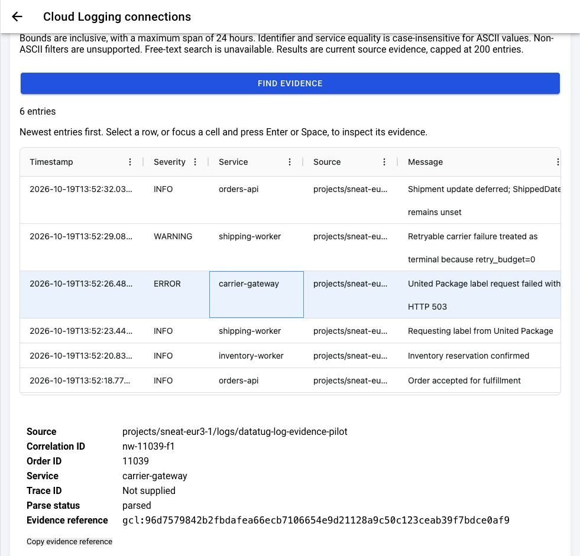
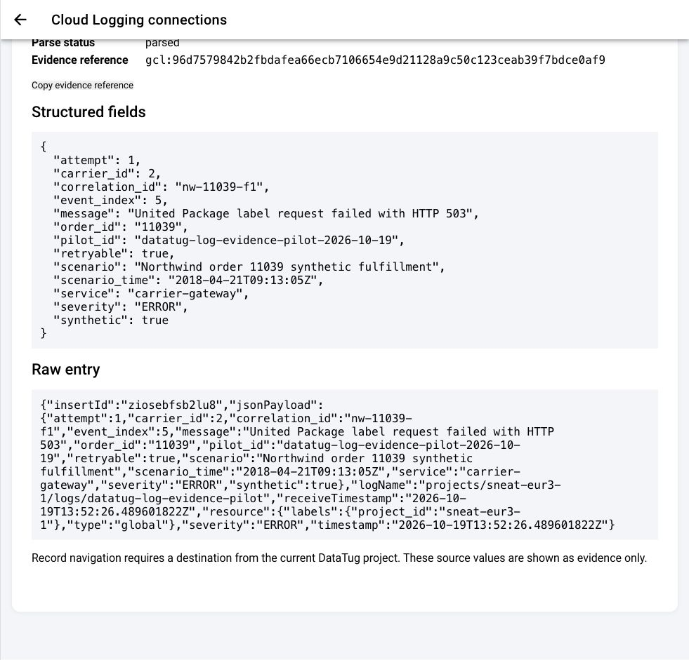

# Direct Google Cloud Logging pilot — execution receipt

Status on 2026-10-20: **hosted consent, synthetic-view access, and a bounded
Google Cloud Logging query are verified in production**. The optional pilot
uses the existing `sneat-eur3-1` project and its dedicated synthetic log view.
The default, reproducible demo remains credential-free and reads the committed
local files described in [the guide](guide.md). The hosted read is direct; no
log database, snapshot, ingestion service, or aggregation system was added.
The verified Firebase identity and auth project remain shared with Sneat.

The owner approved the Google unverified-app consent prompt for
`openid email logging.read` and offline consent. A replacement provider
identity was selected; its email, UID, Google subject, and grant ID are omitted
from this receipt. It has no direct project roles. Its only Logging access is
`roles/logging.viewAccessor` on the synthetic pilot view. The earlier
unrecognized test-identity binding was removed at `13:15:56Z`.

The Google OAuth audience readback shows the app is **In production**, user
type **External**, and **requires verification**. Its consent screen displays
a `2 users / 100` usage display; this is project-wide and does not count DataTug Logging
grants. No OAuth audience settings were changed. Resolve the sensitive-scope
verification requirements and assess the project-wide cap before broader
rollout.

On production revision `datatug-cloud-00010-bjt`, the OAuth callback POST
returned 303 at `13:21:01.118Z`; the signed-in finish POST returned 200 at
`13:21:34.563Z`. Connecting the synthetic view returned 200 at
`13:22:08.821Z`. A probe against the existing `_Default/_AllLogs` view returned
403 at `13:23:05.371Z`, and the Google UI showed access denied. No broader
permission was added. In the hosted query window
`2026-10-19T13:52:00Z`–`13:53:00Z`, the UI queried order `11039` and rendered
six synthetic events in the actual AG Grid. Selecting the carrier `ERROR`
row shows the original raw JSON and fields, including correlation
`nw-11039-f1`, `synthetic: true`, and the Google source reference. Combining
severity `ERROR` with uppercase correlation `NW-11039-F1` and service
`CARRIER-GATEWAY` returns the same one carrier error; an unmatched identifier
shows “No entries matched this bounded query.” A window longer than 24 hours
shows “Choose a time range no longer than 24 hours.” These captures omit
account details.

To repeat this in the [production DataTug UI](https://datatug.app), open
**My connections → Google Cloud logs**, select the connected synthetic pilot
view, and query order `11039` in the one-minute UTC window above. The default
local walkthrough remains available through [the credential-free guide](guide.md).



*Actual hosted AG Grid query for order 11039 in the bounded 24-hour window.*



*Selected carrier error shows the original JSON, synthetic marker, correlation,
and Google source reference.*

Removing the view returned HTTP 200 at `13:29:54.767971Z` and left the Google
grant connected with zero views. Reconnecting that view returned HTTP 200 at
`13:30:32.994803Z` without another Google consent. Repeating the six-entry
query returned HTTP 200 at `13:30:57.423543Z`. All three requests used
production `datatug-cloud-00010-bjt`. Google-wide
disconnect or token revocation has **not** been executed. Hosted log-to-record
navigation remains a product gap; the local file demo already demonstrates
record↔log context. Data remains synthetic, with no persistent log copies.

## Current operator targets — checked 2026-10-20

[Host PR #18](https://github.com/datatug/datatug-cloud/pull/18) moved new
deployments to Belgium (`europe-west1`), at merge
`ffd7b6fc2216cce9c7691678481fea35fd984ad1`. Use the Belgium service URL
`https://datatug-cloud-354fvnqbaa-ew.a.run.app` for the future cleanup POST and
its OIDC audience. The intended Scheduler location is also `europe-west1`.
The approved KMS key and Secret Manager replication remain in `europe-west3`;
the host move did not move these resources.

Provider readback at 07:39:57 UTC found Belgium production revision
`datatug-cloud-00002-lcj` and preview `datatug-cloud-preview-00002-4gc`, each
at 100% traffic on the PR #18 image tag. Both GET health checks returned 200
with `X-Sneat-Service: datatug-cloud` at 07:41:09 UTC. The Frankfurt services
remain present, configured on the earlier PR #17 revisions recorded below. Neither
region had personal Cloud Logs environment variables or OAuth secret bindings,
and neither had the named pilot Scheduler job. Before activation, inventory
both regions and any tagged revisions, direct targets and in-flight work;
checking only the new Belgium deployment does not establish the activation
barrier. These were read-only checks; no service was enabled or deleted.

The execution receipts below retain their original dates and regions.

### Deployment and lifecycle receipts — 2026-10-20

The following deployment and lifecycle receipts predate the hosted Google
consent and query verified in the status above. The 13:09 account-chooser
checkpoint is historical and was superseded by the successful replacement
identity flow at 13:21–13:23. Cleanup and deployment receipts remain relevant
to their stated operations; they do not establish which records were deleted.

Host PR #25 merged as `9d055b12fae5ae74793e8f452bd7fc8714e22d33`. Exact-main
CI passed 10/10 at `13:00:44Z`; deployment `39426215088` succeeded. Provider
readback at `13:07:48Z` found Belgium production `datatug-cloud-00010-bjt` and
preview `datatug-cloud-preview-00009-2fx`, both at 100% on the merged image.
Production master and user routes are `1`, secret references are `2`/`1`, and
the allowlisted UID matches. Preview and Frankfurt remain without pilot
configuration; all four health checks returned HTTP 200. The standard Firebase
`auth_time` fix is now deployed.

The approved activation CAS resumed epoch `1` to epoch `2` at
`13:09:15.798Z` on production `00010-bjt`; readback confirmed
`paused=false` and durable epoch `2`. The disposable Scheduler probe was
deleted and returned `NOT_FOUND` at `13:10:25Z`. The recurring cleanup remains
enabled and minutely; three scheduled target requests returned HTTP 200 at
`13:06:08Z`, `13:07:07Z` and `13:08:04Z` on `00010-bjt`, using OIDC without
`X-Cron-Secret`. These responses do not identify affected records.

At the 13:09 checkpoint, fresh basic sign-in reached the connections page,
which showed no accounts or views; GET connections and OAuth start returned
HTTP 200. The selected provider identity was not recognized at that time.
Those statements describe the earlier failed attempt, superseded by the live
consent, fixed-view connect, denied broader-view probe, and hosted AG Grid query
recorded at the top of this guide.

Live production readback at `12:26:19Z` found Belgium production revision
`datatug-cloud-00008-2rw` and preview revision `datatug-cloud-preview-00007-hmj`,
both at 100% traffic on image `852c5cacd7925d8e7d30749e3e9babfb88d201ba`.
Production runtime configuration references OAuth client Secret Manager
version `2` and state-key version `1`; the master feature flag and user routes
are both `1`. At this earlier readback, the allowlisted lifecycle was paused
at epoch `1`; it was later resumed as recorded above.
The private operator control returned HTTP 200 for OIDC status at
`11:51:44.410251Z` and HTTP 401 without authentication. A pause with expected
epoch `0` returned HTTP 200 at `12:01:27.524850Z`; Firestore readback confirmed
`paused=true` at epoch `1`. These receipts do not prove Google Logging consent,
a user log query or deletion of expired records. One owner-approved cleanup
check is recorded below.

The existing task invoker already has `run.invoker`; no new invoker IAM grant
was added. The restricted test identity has no direct project role; its
view-only binding is on the synthetic pilot view, but positive and negative
read checks remain pending. The managed cleanup job
`datatug-personal-cloud-log-cleanup` is enabled in `europe-west1` on
`* * * * *` UTC, using the existing task service account, Belgium service URL
as audience and the existing `/_tasks` URI. The approved scheduled target
request returned HTTP 200 at `12:22:00.796489Z` on revision
`datatug-cloud-00007-lt8`; OIDC target matched and `X-Cron-Secret` was absent.
The earlier single approved check returned HTTP 200 at `12:15:20.352921Z` on
revision `datatug-cloud-00006-fc2`. Neither receipt establishes which records
were deleted. At this checkpoint, the temporary Scheduler probe had been re-paused in the
operation's `finally` cleanup; it was later deleted and returned `NOT_FOUND` as
recorded above. Run `39421223763` attempt 2 passed WB 10/10 at
`12:26:53.834799Z`. The four Belgium and Frankfurt production/preview health
checks returned HTTP 200 with the expected service header. Preview and both
Frankfurt services had no personal Cloud Logs settings; the Frankfurt services
remain on their existing revisions. Post-deployment runtime readback confirms
master `1`, routes `1`, secret references `2`/`1` and the allowlisted UID match.

At the `12:26Z` checkpoint, lifecycle activation was still paused at epoch `1`
and the deployed image predated the auth-time fix. The later merge, deployment
and epoch-2 resume receipts are recorded above. No Google Cloud Logging user
grant exists; positive/negative view reads and hosted consent remain
unverified.

Before activation, preflight found all 35 retained DataTug revisions across
Belgium and Frankfurt and all 7 current project Cloud Run services without
personal Cloud Logs settings. All 9 credential roots were empty at
`11:36:36Z`. The deployed Firestore ruleset was byte-equal to reviewed origin
main SHA `a78abcd7e55258b93ba996b7bfe1e48149cfe029`, with SHA-256
`9038e32d45753b5ebe62ac078743da5b0cd7eadb40b9dfedae723c8bf245d8d2`. This
supports the pre-activation old-writer check; it is not a blanket shutdown
proof.

At the earlier 12:15 cleanup check, exactly one
`DataTugPersonalCloudLogCleanup` target request returned HTTP 200 at
`2026-10-20T12:15:20.352921Z` on production revision
`datatug-cloud-00006-fc2`. The temporary probe was re-paused in `finally` and
the managed recurring job was paused at that checkpoint. This receipt proves
the target request returned success, not which records (if any) were deleted.

The CICD scheduler-header fix merged as [PR #45](https://github.com/sneat-co/cicd/pull/45)
at `3d89e25a11d042b4c855765e58ec876838780679`; its fake-provider regression
passed on the exact candidate and post-merge main CI passed 6/6. OIDC updates
now clear workflow-owned custom headers before attaching OIDC. No protocol
change was made.

The approved managed cleanup schedule is enabled and its target returned HTTP
200 as recorded above; no receipt identifies affected records. Automatic
review had rejected an earlier potentially destructive operation; the owner
later approved the bounded cleanup check and recurring job. No Cloud Logging
user grant exists.
Earlier dated provider snapshots below remain historical and do not describe
the current runtime configuration or Scheduler state.

## What exists

| Item | Observed state |
| --- | --- |
| Logging bucket | `projects/sneat-eur3-1/locations/global/buckets/_Default`, active, 30-day retention |
| Log view | `projects/sneat-eur3-1/locations/global/buckets/_Default/views/datatug-log-evidence-pilot` |
| View filter | `log_id("datatug-log-evidence-pilot") AND resource.type="global"` |
| View IAM | The selected replacement Google identity has no direct project roles; its only Logging role is `roles/logging.viewAccessor` on this synthetic view. Hosted connect and query succeeded. A probe against `_Default/_AllLogs` returned 403 and Google showed access denied; no broader access was added. |
| Pilot entries | Eight structured entries written on 2026-10-19 to the dedicated log ID: six for order `11039`, one each for `11038` and `11040` |
| Classification | Every payload has `synthetic: true`, `pilot_id: datatug-log-evidence-pilot-2026-10-19`, and an `event_index` |
| Source access tested | Hosted query succeeded with the replacement identity under view-only IAM. The earlier Editor identity and its binding were retired from this pilot. |
| Hosted service and cleanup | Host PR #15's historical provider snapshot at 18:05:25 UTC found production datatug-cloud-00013-hjk and preview datatug-cloud-preview-00014-np9, both at 100% traffic on image e5925566ab0c81f95a7bbe46b73fd9836f1c024f; neither had Cloud Logs environment variables or OAuth secret bindings, and no pilot Scheduler job existed. README-only host PR #16 merged at b5c6c8444fd3c98c177d441b47f691cbdfae1d5b. Candidate build/lint [39299058079](https://github.com/datatug/datatug-cloud/actions/runs/39299058079), post-merge Go CI [39299663820](https://github.com/datatug/datatug-cloud/actions/runs/39299663820), and deployment [39299949750](https://github.com/datatug/datatug-cloud/actions/runs/39299949750) passed. Provider readback at 18:11:59 UTC found production datatug-cloud-00014-lhg and preview datatug-cloud-preview-00015-6w6 at 100% traffic on the PR #16 image; both had no Cloud Logs environment variables or OAuth secret bindings, and no pilot Scheduler job existed. GET /health-check returned 200 with X-Sneat-Service: datatug-cloud at 18:12:01 UTC. The user-routes switch omits all eight handlers while retaining cleanup registration and credentials when enabled; it was not exercised with the master feature enabled. No grant, live cleanup or shutdown proof exists. |
| Production DataTug UI | [Apps PR #407](https://github.com/datatug/datatug-apps/pull/407) merged at `a63cfe2883d1078f9a3c1058483197126ea372de`; post-merge [CI run 39292521711](https://github.com/datatug/datatug-apps/actions/runs/39292521711) passed preflight, build, test, Cloud Logs E2E and deploy-gate checks. Cloudflare workflow [39293867514](https://github.com/datatug/datatug-apps/actions/runs/39293867514) succeeded; public build-info reports the same SHA and version `0.1.0+1201`. The production UI flag is on behind the fail-closed server-confirmed UID gate; Business Preview is off. At this earlier PR #407 checkpoint, no post-deploy CI smoke was run and the backend configuration was absent, so access remained denied. |
| Activation backend | [Backend PR #67](https://github.com/datatug/backend/pull/67) merged at `d3112f646accffedcc7279995ea7362c390f8e8c`. Reviewed candidate `7a52784dbdf7e923941fc66f202ad8092e15be65` passed [Backend CI 39308503102](https://github.com/datatug/backend/actions/runs/39308503102) and [Security 39308502042](https://github.com/datatug/backend/actions/runs/39308502042). The local full Firestore adapter suite passed with `-race`, 100% statement coverage and zero uncovered statements in 14.416s. Published `v0.38.0` points to that merge commit. Post-merge [Backend CI 39309725492](https://github.com/datatug/backend/actions/runs/39309725492) and [Security 39309724286](https://github.com/datatug/backend/actions/runs/39309724286) passed; WB verified the exact target at 19:25:05 UTC. No live lifecycle invocation is claimed. |
| Activation host | [Host PR #17](https://github.com/datatug/datatug-cloud/pull/17) merged at `669728342d2b9c36d7b37e254c821ba19b4162bf`, pinning backend `v0.38.0`. Reviewed candidate `a67028d5f689d0ff0f73719d535cd638836780de` passed [Go CI 39313747372](https://github.com/datatug/datatug-cloud/actions/runs/39313747372), including build/test, lint and the actual Firestore-emulator HTTP journey with `-race` (8.446s). The local full host race suite had 100% statement coverage and zero uncovered statements. The private fixed-UID OIDC control supports status, pause, resume and bounded durable reconciliation; its synthetic tests use fake OAuth/KMS/OIDC and do not prove live authenticated task delivery or Google consent/read/revoke. Post-merge [Go CI 39314930149](https://github.com/datatug/datatug-cloud/actions/runs/39314930149) and [deployment 39316404362](https://github.com/datatug/datatug-cloud/actions/runs/39316404362) passed; WB verified all ten exact-target checks at 20:09:41 UTC. Provider readback at 20:09:47 UTC found production `datatug-cloud-00015-vdq` and preview `datatug-cloud-preview-00016-p9d` at 100% traffic, both configured with the merge SHA image tag. Their immutable image digests are respectively `dfc28e7b327c4950d8ec1d1955851975b08a0aa3a4c2a32659d905b18d773115` and `6af0f4fc286dce15a5fad73c42213750d73d50daf60ebd36f7e67bdab7adaaa9`. Both had no personal Cloud Logs environment variables or OAuth secret bindings, and no pilot Scheduler job existed. GET health checks at 20:10:10 UTC returned 200 with `X-Sneat-Service: datatug-cloud` for both services. The code is deployed with the master feature off; no live lifecycle invocation or hosted Google journey is claimed. |

The eight Cloud Logging entry timestamps span
`2026-10-19T13:52:15.978008256Z` through
`2026-10-19T13:52:34.256091102Z`. The six order `11039` entries use provider
insert IDs `zskt5tf9o699d`, `1cw4bybf71nrip`, `uuahwwfb5mvfp`,
`ziosebfsb2lu8`, `1amb2z8f2nv2vg`, and `dx4bgbftyrg7w` in event order.

The payloads reproduce the committed Northwind fixture's six-event causal
sequence, with `scenario_time` holding the illustrative 2018 time. Cloud
Logging's entry timestamp is the **2026 pilot write time**. The synthetic
carrier HTTP 503 and `retry_budget=0` explain only this demonstration, not the
historical reason Northwind order 11039 lacks `ShippedDate`. No real Sneat
operational log was copied into the pilot log ID.

The view was created with `gcloud logging views create` and the eight entries
were written with `gcloud logging write --payload-type=json`. A direct view
read returned eight entries. The following check was executed successfully
with absolute UTC bounds. It remains repeatable while the bucket retains the
entries (30 days from the write), subject to the reader's view access:

```sh
gcloud logging read \
  'timestamp>="2026-10-19T13:52:00Z" AND timestamp<="2026-10-19T13:53:00Z" AND jsonPayload.pilot_id="datatug-log-evidence-pilot-2026-10-19"' \
  --project=sneat-eur3-1 --bucket=_Default --location=global \
  --view=datatug-log-evidence-pilot --freshness=30d --limit=20 \
  --format=json
```

The existing `cloudlogging.NewPersonalDB` adapter was also exercised with a
user token from the active `gcloud` session and this **fixed view resource**.
One bounded DALGO query used the inclusive UTC range
`2026-10-19T13:52:00Z` to `2026-10-19T13:53:00Z`, `order_id == "11039"`,
descending timestamp order and limit 10. It returned exactly six rows, in
this order: deferred shipment, zero retry budget, carrier HTTP 503, label
request, inventory reservation, order acceptance. The token was captured in
memory by a temporary local probe and was never printed or committed. This
establishes a real direct-read path through DALGO; it does not establish the
hosted OAuth consent, narrow IAM or browser path.

## Approved credential provisioning — 2026-10-19

The owner approved storing this client's JSON credentials in Secret Manager and
creating the named KMS resources. The following operations were executed:

- Stored the client secret as version `1` of
  `projects/sneat-eur3-1/secrets/datatug-cloud-logs-oauth-client-secret`, with
  user-managed replication in `europe-west3`. The downloaded JSON's client ID,
  project and callback were checked before upload. Secret read-back matched in
  memory, and the temporary JSON was deleted. No credential file is in Git.
- Created key ring `datatug-cloud-logs` and key `google-oauth-grants` in
  `sneat-eur3-1/europe-west3`. Its primary version `1` is enabled, uses software
  protection, and has purpose `ENCRYPT_DECRYPT`. This verifies provisioning,
  not application encrypt/decrypt permission or a completed user grant.

During browser recovery, a tool ignored output suppression and emitted the
client secret into private tool output. Independent security review then
required replacing it before activation, storing a new pinned Secret Manager
version and retiring the original Google credential after verification. The
owner created that replacement on 2026-10-20, as recorded below. At this checkpoint,
no Google user grant or runtime secret binding existed, and no Google
user-token revocation was performed. Current runtime configuration is recorded
above.

After automatic approval review required exact permission, the owner separately
approved and the following prerequisites were applied:

- `roles/cloudkms.cryptoKeyEncrypterDecrypter` for the existing runtime account
  `588648831063-compute@developer.gserviceaccount.com` on the named KMS key only.
- Version `1` of `datatug-cloud-logs-oauth-state-key`: a standard-base64 encoding
  of 32 random bytes, generated and transferred in memory, with read-back
  equality verified. Its sole replication location is `europe-west3`. The
  application uses this as an AES-GCM key for short-lived pending PKCE
  verifiers and nonces, bound to the state hash and UID. KMS separately
  encrypts Google refresh tokens; neither storage path stores log entries.

Existing project-level Secret Manager access remains unchanged. The runtime
identity is shared, so other workloads using it also have access to this new
key; that is an explicitly approved pilot limitation. At this 2026-10-19
checkpoint, the Scheduler job and hosted activation were unprovisioned. Generic release
wiring is merged in [CICD PR #44](https://github.com/sneat-co/cicd/pull/44)
at `9571a3c78a448598ccce184a2aa7625ab07d6a53`; its 133 fake-provider step
checks passed locally and independently. That is not provider activation.

### Credential replacement — 2026-10-20

The owner clicked **Add secret** on the dedicated client. Its downloaded JSON
was checked against the client ID and project, made private, and processed in
memory. The replacement differs from the original secret, is stored as enabled
Secret Manager version `2`, and matched a private read-back. The temporary JSON
was deleted. Secret Manager version `1` is now disabled; the state-key secret
remains version `1`. The non-secret GitHub repository selector
`DATATUG_PERSONAL_CLOUD_LOGS_CLIENT_SECRET_VERSION` is pinned to `2`. At the
time of this secret readback, the master feature variable was absent and no
runtime binding had been added; current runtime references are recorded above.

At this credential-replacement checkpoint, no Google user grant or runtime
secret binding existed. The replacement identity's consent and hosted query
were completed later as recorded above. Google-wide disconnect/revocation has
not been executed. Production routes are enabled, and the allowlisted lifecycle
was resumed from epoch `1` to epoch `2`; current runtime and resume receipts are
recorded above.

## Remaining live-pilot checks

- Exercise the owner's explicit Google **Disconnect Google access** action and
  verify provider revocation plus local cleanup. It has not been executed; the
  successful connect and view removal do not revoke the Google grant.
- Implement hosted log-to-record-to-log navigation. The live hosted UI currently
  queries and displays the synthetic events, while the local file demo supports
  record-to-log context. Investigation and Detective persistence gaps also
  remain unchanged.
- Keep the production consent and fixed-view query opt-in and limited to the
  synthetic pilot. The source view has 30-day retention. Confirm consent-screen
  verification classification and Cloud Logging billing/quota behavior in the
  actual project before public launch.
- Full hosted shutdown has no live proof. The route-stop switch does not revoke
  grants; before turning off the master feature flag after activation, prove a
  no-further-activation barrier across serving and older revisions and in-flight
  OAuth requests, take a final grant inventory, then verify revocation and
  cleanup while the required credentials remain available. Turning the master
  flag to `0` removes cleanup registration and its credential bindings.
- The live pilot changed neither Firebase identity/auth project nor the OVDB
  public contract. No log ingestion, database copy, snapshot, or AI step was
  introduced.

The view is temporary pilot state. Its resource description records
`sneat-eur3-1` project administrators as operational owner and a review date
of **2026-11-18**. The owner can keep this working connected pilot through that
review. Proposed teardown, **not executed**, is `gcloud logging views delete
datatug-log-evidence-pilot --bucket=_Default --location=global
--project=sneat-eur3-1`. Deleting the view does not delete its entries;
the `_Default` bucket retains them for 30 days. The managed cleanup Scheduler
job remains enabled, and scheduled target requests returned HTTP 200 without
identifying affected records. The disposable probe was deleted and returned
`NOT_FOUND`. The Cloud Run master feature and user routes are `1`; the
allowlisted lifecycle is active at epoch `2`. Host PR #25 is deployed as source
`9d055b12fae5ae74793e8f452bd7fc8714e22d33`. The approved KMS key, key-level
runtime permission, state-key version `1`, and OAuth client-secret version `2`
exist as recorded above; stored client-secret version `1` is disabled.
